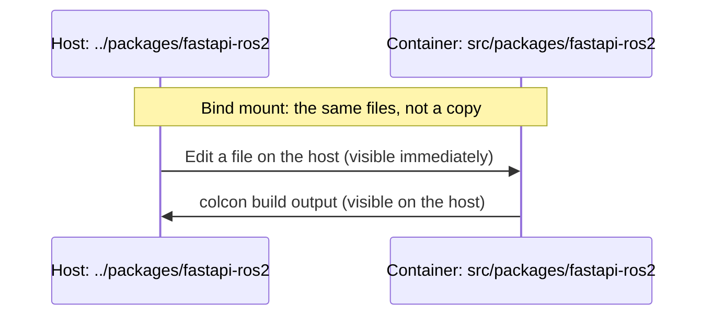

# VSCode ROS2 Workspace for IoT applications

This is the **ROS2 Docker development environment**.

It is a fork from the [**VSCode ROS2 Workspace Template** (vscode_ros2_workspace)](https://github.com/athackst/vscode_ros2_workspace/tree/humble) project for the [iron](https://github.com/athackst/vscode_ros2_workspae/tree/iron) distro.


This project also incorporates [`colcon-poetry-ros`](https://github.com/UrbanMachine/colcon-poetry-ros)
into the Docker image for the packages dependency management, allowing the configuration of the packages with
a `pyproject.toml` file and installing them and their dependencies with [Poetry](https://python-poetry.org/).

---
**NOTE**

The `colcon-poetry-ros` plugin allows [colcon](https://colcon.readthedocs.io/en/released/) to build the nodes
but it does not seem to make them available to ROS2 out of the box, which
results in the `"ros2 run"` command not working to launch them (I assume the same would apply for any launch files,
even though I have not confirmed it). This is work in progress but, for now, please see the section [Running the nodes](README.md#running-the-nodes)
for more info on how to run the nodes (these are just Python scripts after all).

---

## Use
For general information about the use of the development container, please refer to the original README file from the
VSCode template project (`.README`).

Once the container is opened in VS Code, all the ros2 commands are available and the packages are available under `src/packages`
(see [Packages](README.md#packages)). Building the packages is possible from the
`ros2-development-workspace` folder (default workspace).

## Packages

The ROS packages you work on live outside this repo, in a folder on the host that the devcontainer bind-mounts into the workspace at `src/packages`.
A bind mount is not a copy, so edits on the host show up in the container immediately and the other way around.
Files created by `colcon build` inside the package folders also appear on the host.
This repo's own `src/` folder is not affected.



By default the host folder is `packages`, next to the clone of this repo.
It must exist before the container starts, otherwise Docker fails to create the mount.
Two optional environment variables on the host change this:

- `ROS_PKG_SOURCE`: folder to mount, relative to this repo (default `../packages`).
- `ROS_PKG_TARGET`: mount point, relative to the container workspace (default `src/packages`).

VS Code only sees these if it is launched from a shell that exports them (for example `ROS_PKG_SOURCE=../foo code .`).
Keep only ROS packages in the source folder, because colcon and `colcon-poetry-ros` pick up every package they find.

### Example: fastapi-ros2

[`fastapi-ros2`](https://github.com/daconjurer/fastapi-ros2) is a ROS2 package with a FastAPI API that exercises topics and services.
It is a good package to test the setup with.
From the directory that contains this repo, on the host:

```
mkdir -p packages
git clone https://github.com/daconjurer/fastapi-ros2.git packages/fastapi-ros2
```

> Note: `ROS_PKG_SOURCE` is the suggested target location for the clone above. 

Then open this repo in VS Code and reopen it in the container.
The package is now at `src/packages/fastapi-ros2` in the container, and [Trying out fastapi_ros2](README.md#trying-out-fastapi_ros2) shows how to build and run it.

## Devcontainer configs

Pick the config that matches the host when VS Code asks which one to open:

- `.devcontainer/mac`: works on macOS (Apple Silicon) and also on Linux in headless mode.
  `--network=host` and X11 are not used, one port is published to the host, and turtlesim runs headless under `xvfb-run`.
  The port is set by the optional host environment variable `ROS_DEV_PORT` (default `8000`), and it is only reachable if the server inside the container binds to `0.0.0.0`.
- `.devcontainer/linux`: uses host networking and the host X11 socket, so turtlesim can show its window.
  Run `xhost +local:` on the host first and start turtlesim without `xvfb-run`.
  This config is untested.

Both share `docker/Dockerfile.dev`.

## Building packages

From the workspace root, in a fresh shell:

```
python3 -m colcon_poetry_ros.dependencies.install --base-paths src/packages --install-base install
colcon build --packages-select <package_name>
source install/setup.bash
```

The first command is required, because `colcon build` alone fails with "No virtual environment exists".
If `install/` is deleted, open a new terminal before rebuilding, because the old virtual environment stays activated in the shell.

## Trying out fastapi_ros2

After building the package (see [Building packages](README.md#building-packages)), start these in separate sourced terminals:

```
xvfb-run -a ros2 run turtlesim turtlesim_node
python3 install/fastapi_ros2/lib/fastapi_ros2/service
cd src/packages/fastapi-ros2 && python3 -m uvicorn main:app --host 0.0.0.0 --port 8000
```

Then, from the host:

```
curl "localhost:8000/services/sum?a=2&b=3"
curl "localhost:8000/services/move_turtle?x=5&y=5&theta=1"
curl "localhost:8000/topics/print"
```

The turtle position can be checked with `ros2 topic echo /turtle1/pose --once`.

## Linting

```
ament_flake8 src/ --config src/ament_flake8.ini
```

## Running the nodes

All the nodes generated by colcon will be in: `install/<package_name>/lib/<package_name>/`. It is then
possible to launch them with:

```
python3 install/<package_name>/lib/<package_name>/<node_name>
```

Or even just like normal Python modules from the package folder in the `src` folder, for instance
(`your_package/your_package/node_module.py`):

```
poetry run python3 -m your_package.your_package.node_module
```
